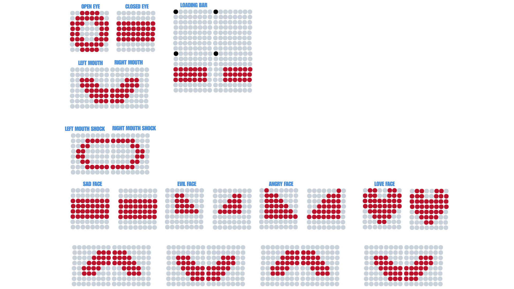
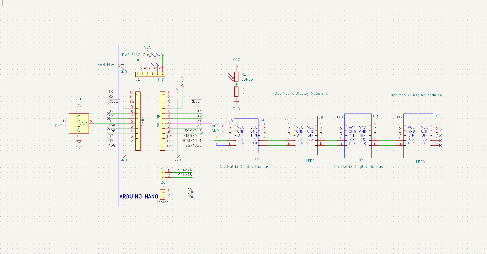

# PICO_Face!!!
My project takes 4 MAX7219 Serial Dot Matrix Display Modules daisy chained together. In other words my project is 4 LED matrix 8x8 joined together in a square. This formation will become the head of my future robot! Right now I'm coding in a sequence and some reactions to data like light and temperature. As I build the brains of my robot in another repository (in the future) I hope to make it easier for the robot to react to the environment around them. 
here's an AWESOME cad look of my project!
)

* MAX7219
* LED MATRIX
* Robot Face
* Arduino NAN)

## HOW THIS WAS MADE
1. I used canva to play around with the matrix looks (see  )
2.  Using Canva I wrote the basic bytes for my Arduino code
3.  I created functions for each expresion I'll be using for my sequence
4.  I added two data inputs in a LDR (Photoresistor) and a DHT11 for temp and humidity settings.
5.  Finished off my code, adding a sequence for the face and reactions to temp and light
6.  Based my cad project off of the Meccano M.A.X's head
7.  Extended the face to fit 4 LED Matrix modules
8.  Added places for LDR, DHT11 and Arduino NANO

## heres how to run the project :)
1. Download Arduino Library "LedControl by Eberhard Fahle"
  ``` #include <LedControl.h> ```

2. Download and copy Arduino Code in [Arduino.ino](https://github.com/manula5454/PICO-Face/blob/697f6334a7c6b1ae7bfd4085c8c991629a414b7b/Arduino/Arduino.ino)

3. Wire up Arduino NANO, LDR, DHT11, 4x MAX7219 Dot Matrix Display Module
  See the [schematic](https://github.com/manula5454/PICO-Face/tree/697f6334a7c6b1ae7bfd4085c8c991629a414b7b/Schematic_PICO)
  

5. Upload the Arduino code onto the Arduino NANO

6. If you have a 3D printer download and print the [CAD files](https://github.com/manula5454/PICO-Face/tree/540d21be290d7b2ce7e66495d8b30e280f9589e1/CAD)

## CODE

I displayed data using:
```
byte eyeOpen[8] = {
 0b00111100,
 0b01111110,
 0b11100111,
 0b11000011,
 0b11000011,
 0b11100111,
 0b01111110,
 0b00111100
};
```
This is how I display each image based off the Matrix image.
